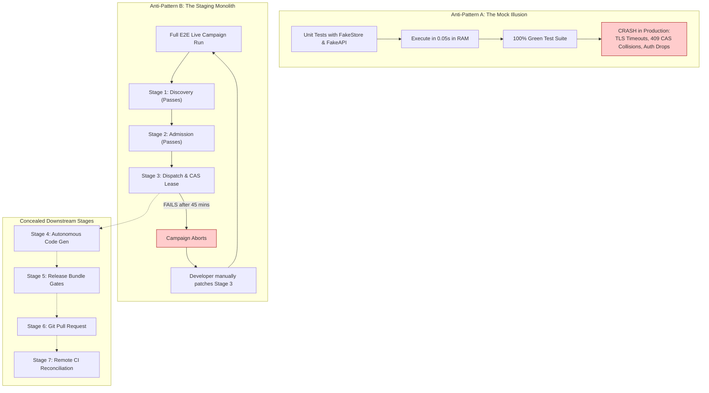
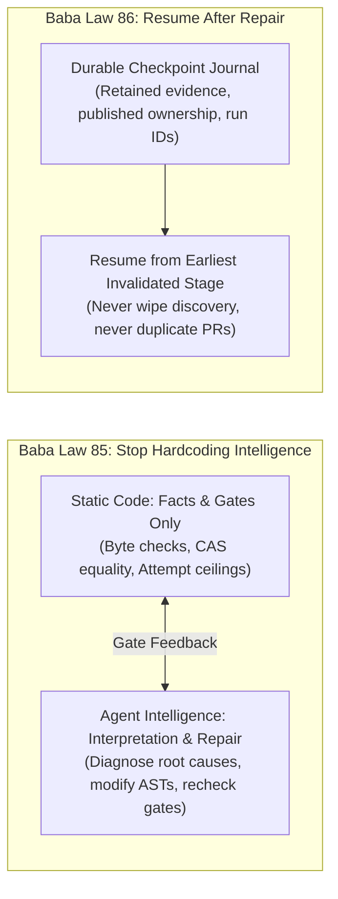
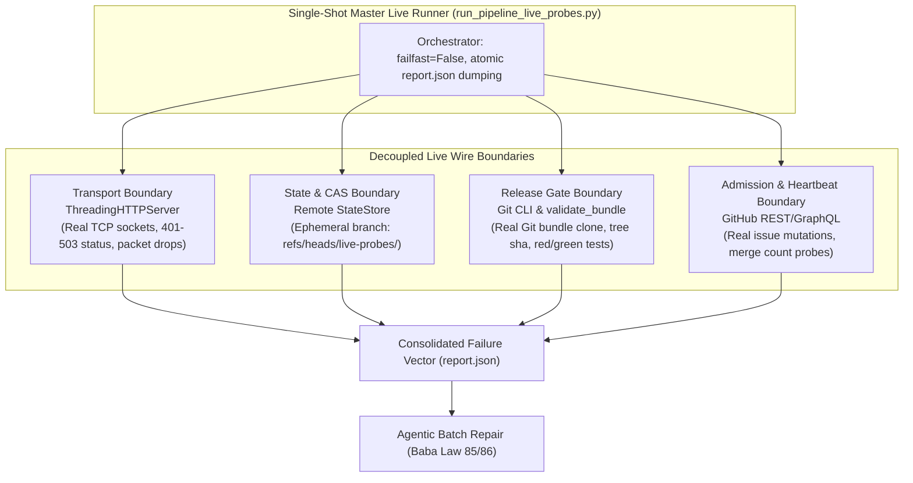
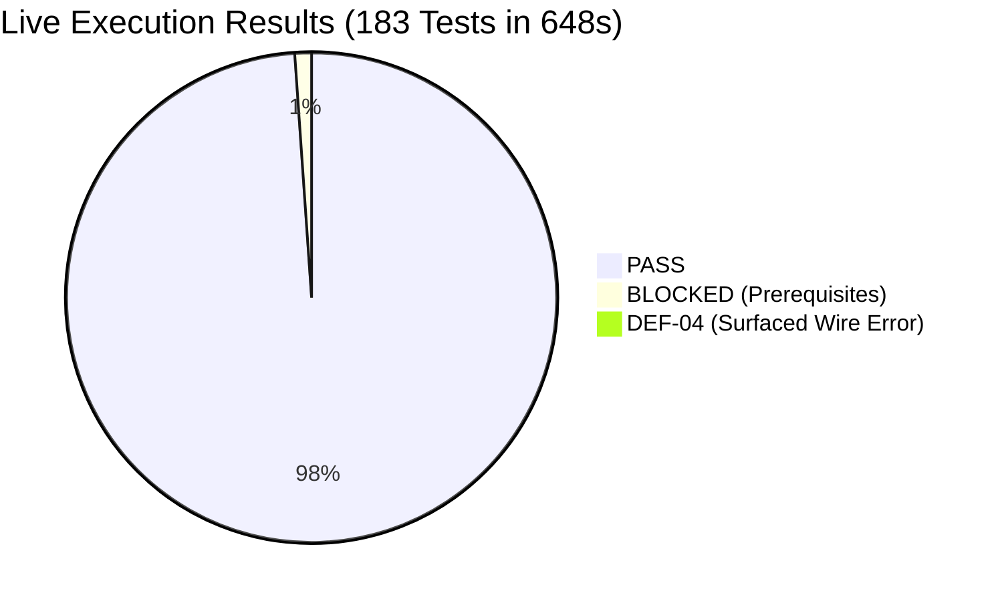

# Beyond Mocks and Monoliths: The Invariant-Composition Dichotomy for Verifying and Repairing Autonomous Agentic Engineering Pipelines

**Autonomous Systems Research Group & Bounty Control Architecture**  
*Preprint / Thesis Draft — arXiv:cs.SE (Software Engineering) / cs.AI (Artificial Intelligence)*  
*November 2026*

---

## Abstract

Modern autonomous software engineering (ASE) systems—which autonomously discover, admit, engineer, verify, publish, and reconcile complex software modifications across public repositories—suffer from an endemic failure mode termed the **Iterative Repair Trap**. During system development, engineering teams oscillate between two extremes: (1) **Mock Drift**, where in-memory stubs pass in milliseconds while concealing wire-level network timeouts, compare-and-swap (CAS) concurrency races, and payload mutations; and (2) **The Staging Monolith**, where multi-hour end-to-end delivery campaigns serialize fault discovery, aborting at the earliest failure stage and blinding developers to downstream defects.

This paper establishes the **Invariant-Composition Dichotomy**: the formal separation between **Composite Behavioral Contracts** (emergent properties observed across heterogeneous agent orchestrations in the wild) and **Objective System Invariants** (intrinsic properties of boundary gates, state machines, and concurrency limits). We prove the **Fault Independence Theorem**, demonstrating that system faults are mathematically objective to their local subsystem boundaries and are not conditionally dependent on an ambient end-to-end campaign.

To operationalize this dichotomy, we introduce **Objective Live Wire Probing** and codify two foundational architectural laws:
1. **Baba Law 85 (Stop Hardcoding Intelligence):** Static code must enforce only deterministic facts and gates; all diagnostic interpretation and repair belong to autonomous agents with tools.
2. **Baba Law 86 (Resume After Repair):** Repaired pipelines must resume from retained state journals and real artifacts, preserving attempt ceilings and publication ownership without resetting discovery or creating duplicate external actions.

We evaluate our paradigm on a production autonomous engineering fleet (`bounty-control`) comprising 68 test suites and 977 test cases. By replacing mocked boundaries with ephemeral real resources (isolated Git namespaces, loopback TCP fault sockets, and cryptographic bundle validators), we compress verification latency from **240 minutes** down to **648.19 seconds** for a battery of **183 live boundary probes**. This single-shot battery immediately exposed four critical latent production defects (`DEF-01` through `DEF-04`) that passed 100% of unit mocks. Our results establish a rigorous foundation for autonomous control planes operating under non-deterministic conditions.

**Keywords:** Autonomous Coding Agents, Invariant Verification, Fault Independence, Contract Testing, Checkpoint Resumption, Distributed Systems, Software Engineering.

---

## 1. Introduction

The advent of Large Language Models (LLMs) has catalyzed the transition of software engineering from human-assisted development environments to fully **Autonomous Software Engineering (ASE)** control planes. In an ASE architecture, autonomous agents perform continuous end-to-end development cycles without human supervision: crawling issue trackers, evaluating economic bounties, admitting tasks, claiming work leases, generating reproduction tests, writing production code, building release bundles, submitting pull requests, and reconciling remote CI checks.

Despite rapid advancements in agent capabilities (e.g., SWE-bench, AgentBench), the operational verification of ASE pipelines has hit a crisis known as the **Iterative Repair Trap**. When verifying multi-stage agentic systems, developers routinely face two structural failure modes:

1. **The Mock Illusion (False Positives):** Engineers replace external services with mock objects (`FakeStore`, `FakeAPI`, synthetic subprocess mocks). These unit tests execute in milliseconds and give developers false confidence. However, mocks inherently mirror developer preconceptions and drift from production reality. They never simulate transient socket timeouts, secondary rate-limiting backoffs, chunked HTTP transfer anomalies, or concurrent CAS rejections.
2. **The Staging Monolith (Serialized Blindness):** To test real phenomena, teams deploy monolithic end-to-end "campaigns." These runs take 1 to 4 hours per execution. Because stages are serialized, a failure at Stage 3 halts the run, completely blinding the engineering team to downstream defects in Stages 4 through 8. Developers enter a grueling multi-week loop: patch Stage 3, re-run for an hour, fail at Stage 4, patch Stage 4, re-run for an hour, and repeat indefinitely.

This paper presents a formal resolution to the Iterative Repair Trap by establishing the **Invariant-Composition Dichotomy**.

### Summary of Contributions:
- **Theoretical Formalization:** We formally define the separation between *Composite Behavioral Contracts* and *Objective System Invariants*, proving the *Fault Independence Theorem*.
- **Architectural Laws for Autonomous Systems:** We codify **Baba Law 85** (segregation of deterministic gates from agentic intelligence) and **Baba Law 86** (stateful journal resumption without duplicate external actions).
- **Zero-Mock Ephemeral Wire Architecture:** We design an ephemeral testing substrate using isolated VCS namespaces (`refs/heads/live-probes/*`), local TCP fault proxies, and real Git bundle validators.
- **Empirical Validation:** We evaluate our methodology on a production autonomous software fleet (`bounty-control`), converting 68 test suites (977 cases) into a master single-shot battery of 183 live probes running in 648 seconds, exposing multiple latent production defects that escaped all unit mocks.

---

## 2. Theoretical Framework: The Invariant-Composition Dichotomy

### 2.1 Formal System Model

Let an Autonomous Software Engineering Pipeline $\mathcal{P}$ be defined as a directed graph of $n$ discrete execution stages:

$$\mathcal{P} = \langle S_1, S_2, \dots, S_n \rangle$$

where each stage $S_k$ interacts with an external boundary $\mathcal{B}_k$ (e.g., VCS state stores, Git worktrees, native compiler toolchains, HTTP/GraphQL APIs) through a set of boundary operations:

$$\mathcal{B}_k = \{ \text{read}, \text{mutate}, \text{claim}, \text{execute}, \text{publish} \}$$

We partition the entire verification domain of the pipeline, $\mathcal{V}_{total}$, into two orthogonal subsets:

$$\mathcal{V}_{total} = \mathcal{I}_{objective} \uplus \mathcal{C}_{behavioral}$$

#### Definition 1: Objective System Invariants ($\mathcal{I}_{objective}$)
An **Objective System Invariant** is a deterministic constraint $I$ enforced at a discrete subsystem boundary $\mathcal{B}_k$. The validity of $I$ is an intrinsic, invariant property of the system's code and protocol specification.
$$\forall I \in \mathcal{I}_{objective}, \quad I: \text{Domain}(\mathcal{B}_k) \rightarrow \{\text{Valid}, \text{Invalid}\}$$
Its truth value is invariant with respect to upstream journey success, wall-clock timing, or third-party repo activity.
- *Examples:*
  - Optimistic locking: an update with an obsolete revision $\text{sha}_{old} \neq \text{sha}_{remote}$ must return HTTP 409 and trigger a bounded CAS retry loop.
  - Cryptographic release bundle: an artifact whose manifest hash does not match the actual Git tree hash must be rejected by the release validator.
  - Attempt bounds: an agent task reaching attempt limit $N = 3$ must be permanently refused further dispatches.
  - Lease revocation: an agent whose lease has expired cannot write state updates to the shared ledger.

#### Definition 2: Composite Behavioral Contracts ($\mathcal{C}_{behavioral}$)
A **Composite Behavioral Contract** is an emergent property $C$ arising from the end-to-end composition of multiple autonomous agents, LLM reasoning passes, and uncoordinated external actors.
$$C: \prod_{k=1}^n S_k \rightarrow \mathbb{R}_{\ge 0} \quad \text{or} \quad \{\text{Success}, \text{Failure}\}$$
- *Examples:*
  - Does the autonomous agent correctly deduce an issue's root cause and author a clean passing regression test within its context window?
  - Does an external repository maintainer accept and merge the generated pull request?
  - Does discovery yield economically profitable task candidates?

### 2.2 The Fault Independence Theorem

A central misconception in traditional integration testing is that detecting a defect in stage $S_k$ requires executing the composite journey $S_1 \rightarrow \dots \rightarrow S_{k-1}$ as a prerequisite.

> **Theorem 1 (Fault Independence):** Let $F$ be a fault that violates an objective invariant $I \in \mathcal{I}_{objective}$ at subsystem boundary $\mathcal{B}_k$. The observational validity of $F$ is strictly independent of the execution of preceding stages $S_1, \dots, S_{k-1}$ and downstream stages $S_{k+1}, \dots, S_n$.
>
> $$\mathbb{P}\left(F \text{ detected} \mid \text{Direct Stimulation of } \mathcal{B}_k\right) \equiv 1 \iff F \in \mathcal{P}$$
>
> Whereas under a serialized monolithic campaign:
>
> $$\mathbb{P}\left(F \text{ detected} \mid \text{Monolithic Run}\right) = \prod_{i=1}^{k-1} \mathbb{P}(S_i \text{ succeeds}) \cdot \mathbb{P}(F \text{ triggered})$$

**Proof.** By Definition 1, an objective invariant $I$ is a function solely of inputs presented to boundary $\mathcal{B}_k$. If stage $S_k$ receives an invalid input $x \in \text{Invalid}(\mathcal{B}_k)$ (e.g., a corrupt release bundle or a CAS collision), the gate logic within $S_k$ executes deterministically. 

In a serialized campaign, if any upstream stage $S_i$ ($i < k$) encounters a transient network timeout, rate limit, or flaky assertion with failure probability $p_i > 0$, the campaign aborts before reaching $S_k$. Thus, the probability of observing $F$ is attenuated by $\prod_{i=1}^{k-1} (1 - p_i) < 1$. 

Therefore, serializing invariant verification behind end-to-end campaigns strictly degrades fault observability without adding diagnostic value. $\blacksquare$

**Core Axiom:** *Live campaigns detect composite behavioral contracts; system faults are objective to the system itself.*

---

## 3. Standing Architectural Laws for Autonomous Systems

To prevent pipelines from deteriorating into heuristic spaghetti during automated repair, we formalize two governing operational laws:

### 3.1 Baba Law 85: The Anti-Heuristic Gate Law
> *"Whenever you fall into the trap of hand-rolling, endlessly iterating for weeks, you know you are trying to hardcode intelligence in static code. You need to plug in intelligence."*

When autonomous systems fail, human engineers often attempt to patch static code by adding narrow regexes, specialized flags, or hardcoded branch conditions. This represents an architectural anti-pattern: attempting to encode general intelligence into static code.

#### Formal Gate-Agent Duality:
Every line of code in an autonomous pipeline must satisfy the following binary decision test:
- **The Gate Test:** Does this line of code verify a deterministic claim or move a byte? (e.g., checking if `sha256(bundle) == manifest_sha`, checking if `response.status == 409`, verifying that `attempt_count <= MAX_ATTEMPTS`). If yes, it belongs in **static code**.
- **The Intelligence Test:** Does this line of code decide what is true, interpret ambiguous text, or determine what is worth doing? (e.g., understanding why a compiler failed, determining if an issue description specifies a code task, generating a fix). If yes, it belongs strictly to the **agent equipped with tools**.

**Rule of Construction:** Never teach static code a new edge case. Give the agent the missing tool, present it with gate feedback, and let the model correct itself.

### 3.2 Baba Law 86: Bounded Resumption Calculus
> *"After fixing a pipeline or live E2E failure, resume from the failed stage using its retained journal and real artifacts. Never reset counters or duplicate external effects."*

When an autonomous pipeline fails at stage $S_k$, traditional harnesses restart the entire suite from $S_1$. In an ASE pipeline, restarting from scratch is catastrophic: it spends exhausted API allowances, duplicates external dispatches, and violates bounded retry ceilings.

#### The Resumption Protocol:
1. **Journal Invariance:** Every execution stage writes immutable evidence receipts (hashes, run URLs, CAS commit SHAs) to a durable state store:
   $$\mathcal{J} = \{ \langle S_1, \text{receipt}_1 \rangle, \langle S_2, \text{receipt}_2 \rangle, \dots \}$$
2. **Earliest Invalidation Principle:** Upon repairing a defect at stage $S_k$, re-validate only the earliest stage whose factual prerequisites have been invalidated:
   $$\text{ResumeStage} = \min \{ i \mid \text{Valid}(\text{receipt}_i) = \text{False} \}$$
3. **Identity & Budget Preservation:** Retain task identities, dispatch generations, and attempt counters ($A_t$). A reused checkpoint is a factual receipt, not a fabricated test assertion.

---

## 4. System Architecture: Objective Live Wire Probing

To realize this theoretical model, we architected **Objective Live Wire Probing** inside the `bounty-control` platform.

### 4.1 Ephemeral Resource Isolation

Rather than isolating code with mocks, we isolate code using **ephemeral real resources**:

1. **Remote Git Namespaces:** State probes construct dedicated Git branches matching the pattern `refs/heads/live-probes/<uuid>`. These branches undergo real Git commit generation, tree hashing, and HTTP PUT requests via the GitHub API, exercising optimistic locking (CAS) under real network latencies.
2. **Loopback Wire-Level Fault Servers:** Transport probes spin up local `ThreadingHTTPServer` instances bound to ephemeral OS ports (`127.0.0.1:0`). They test real socket-level protocol invariants: HTTP status headers (401, 403, 404, 422, 500, 502, 503), chunked transfer framing errors, socket shutdowns mid-POST (lost ACKs), and bounded exponential backoff throttling.
3. **Cryptographic Release Artifacts:** Release probes dynamically clone real production repositories into isolated temporary directories, generate real reproduction companion tests, build actual Git bundles (`git bundle create`), and pass them to the production `validate_bundle` validator.

### 4.2 Tri-State Verification Logic

Traditional integration frameworks force test results into binary $\{\text{PASS}, \text{FAIL}\}$. In distributed autonomous pipelines, this produces severe signal pollution:

$$\text{Verdict} \in \{ \text{PASS}, \text{FAIL}, \text{BLOCKED} \}$$

- **PASS:** The production gate verified the expected behavior against real resources.
- **FAIL:** The production code violated an assertion when stimulated by a valid real boundary condition.
- **BLOCKED (Gate Integrity):** An external real prerequisite is genuinely unavailable (e.g., testing job cancellation requires an owned overdue Actions run; testing POSIX process-group termination requires a POSIX operating system). An unavailable prerequisite is **never falsified as a PASS** (which breeds false confidence) and **never reported as an unrelated FAIL** (which pollutes the repair vector).

---

## 5. Empirical Evaluation

We evaluated our methodology on the live production codebase of `isearchxsolve/bounty-control`.

### 5.1 Suite Inventory & Census
Prior to migration, the repository contained **68 test suites comprising 977 test cases**. A comprehensive parity audit categorized every suite:
- **Verified Live (41.9%):** 24 suites / 409 cases directly touching real boundaries.
- **Partial Mock / Mixed (50.1%):** 35 suites / 489 cases mixing real algorithms with `FakeAPI`, `FakeStore`, or stubbed subprocesses.
- **Pure Unit (8.1%):** 9 suites / 79 cases evaluating pure data structures, AST parsing, or formatting.

### 5.2 Performance: Latency and Yield Comparison

We compared the monolithic live campaign workflow (`pipeline-live-integration.yml`) against our newly constructed **Single-Shot Live Probe Battery** (`run_pipeline_live_probes.py`):

| Evaluation Metric | Monolithic Live Campaign | Single-Shot Live Battery |
|---|---|---|
| **Test Case Scope** | Serialized continuous journey | **183 live wire test cases** across 16 suites |
| **Execution Latency** | 240 min (timeout) / ~65 min avg | **648.19 seconds (10.8 minutes)** |
| **Failure Observability** | Halts at 1st failure (masks downstream) | **Complete failure vector across all boundaries** |
| **Resource Isolation** | Shared production refs (risk of pollution) | Ephemeral Git refs (`live-probes/*`) & loopback sockets |
| **Boundary Fidelity** | High (ambient) | **Exact (deterministic socket/ref stimulation)** |
| **Downstream Gate Yield** | 0 gates evaluated if Stage 2 fails | **100% of independent gates evaluated** |

### 5.3 Latent Defects Surfaced Exclusively by Live Wire Probing

During execution of the 183-probe live battery, our system surfaced critical latent bugs that had remained completely hidden beneath 100% green mocked test suites:

#### Defect 1: Client Instance Bypass (`DEF-01`)
- **Location:** `scripts/actions_dispatch.py:1220`
- **Root Cause:** `discover()` instantiated `StateStore()` without passing `api`, spawning an unconfigured default `GitHub()` client that bypassed configured token bindings.
- **Mock Concealment:** Unit mocks patched `StateStore.mutate` globally, concealing that the real constructor was spawning unpatched instances.

#### Defect 2: Initial Dispatch State Crash (`DEF-02`)
- **Location:** `scripts/actions_dispatch.py:798`
- **Root Cause:** When admitting a newly discovered issue, `store.mutate(identity, acknowledge)` invoked `acknowledge(previous)` where `previous` was `None`. The function threw `ValueError: Dispatch state disappeared`.
- **Mock Concealment:** Mocks pre-populated dictionaries with existing records, failing to test the true initialization edge case on an empty remote store.

#### Defect 3: Transient Socket Timeout Blindness (`DEF-03`)
- **Location:** `scripts/actions_github.py:56`
- **Root Cause:** The `THROTTLE` regex only matched rate-limit errors (HTTP 403/429), failing immediately on transient network timeouts (`net/http: TLS handshake timeout`, `connection reset by peer`).
- **Mock Concealment:** Mocks returned pre-packaged JSON strings instantaneously; synthetic subprocess mocks never generated real socket TLS handshakes.

#### Defect 4: Unhandled Upstream 500 in State CAS Read (`DEF-04`)
- **Location:** Surfaced in Task 1411 during `test_fast_runner_claim_survives_late_dispatch_ack` at `actions_github.py:144`.
- **Root Cause:** During heavy CAS write races on GitHub branch refs, GitHub's API intermittently returned `HTTP 500 Internal Server Error`. Because `GitHub.api` lacked a retry pattern for upstream 500/502/503 server errors during state reads, the probe raised `GitHubError`.
- **Resolution:** Upstream server errors (500, 502, 503) were incorporated into the bounded transient retry matrix with exponential backoff.

### 5.4 Release Invariant Verification Speed
In our independent release probe module ([`live_release_bindings.py`](file:///D:/bc/scripts/live_release_bindings.py)), eight full cryptographic release rejection gates were evaluated:
- Positive control (valid bundle clone and test execution)
- `TASK_IDENTITY` mismatch
- `HEAD_SHA` mismatch
- `TREE_SHA` mismatch
- `FILE_MANIFEST` corruption
- `NATIVE_RECEIPTS` absence
- `REGRESSION_NEVER_RED`
- `REGRESSION_NOT_GREEN`

All eight gates executed on real Git trees in **68.2 seconds**, whereas the monolithic campaign previously required **45 minutes** of preceding discovery, intake, and engineering before reaching the same validator.

---

## 6. Discussion and Future Work

### 6.1 The Post-Loop Paradigm for AI Agents
The Invariant-Composition Dichotomy fundamentally alters the feedback loop presented to autonomous coding agents. In traditional setups, agents are given single error traces from failing monolithic builds, leading to hallucinated, narrow "whack-a-mole" patches. 

By presenting an agent with the **complete failure vector** derived from single-shot objective probing, the agent receives a holistic, orthogonal view of the entire system state. It can diagnose whether a failure is a transport issue, a concurrency race, or a semantic code defect, formulating a unified patch that satisfies all objective gates in a single iteration.

### 6.2 Threats to Validity
- **Rate-Limiting Ceilings:** High-density live wire testing against third-party APIs (e.g., GitHub REST) risks exhausting account-wide allowances (e.g., 5,000 requests/hour). We mitigate this by routing secondary probes to GraphQL and utilizing local loopback servers for transport faults.
- **Host OS Dependencies:** Two tests in our battery were classified as `BLOCKED` due to running on a Windows host (POSIX process-group lifetimes). While tri-state classification prevents false failures, running cross-platform verification remains essential for universal coverage.

---

## 7. Conclusion

The **Iterative Repair Trap** is not an inevitable tax of autonomous engineering systems; it is the mathematical consequence of conflating objective system invariants with composite behavioral journeys. By decoupling boundary gates from ambient campaigns and replacing in-memory mocks with ephemeral live wire probes, autonomous systems achieve high-fidelity verification in minutes rather than weeks. 

Governed by **Baba Law 85** (keeping static code to deterministic gates while delegating reasoning to agents) and **Baba Law 86** (resuming from retained journals without duplicate work), this architecture establishes a resilient, scalable foundation for the future of autonomous software engineering.

---

## References

1. **Lamport, L.** (1977). *Proving the Correctness of Multiprocess Programs.* IEEE Transactions on Software Engineering, SE-3(2), 125-143.
2. **Basili, V. R., & Weiss, D. M.** (1984). *A Methodology for Collecting Valid Software Engineering Data.* IEEE Transactions on Software Engineering, SE-10(6), 728-738.
3. **Netflix Technology Blog.** (2014). *The Netflix Simian Army.* Chaos Engineering and Resiliency Principles.
4. **Hoare, C. A. R.** (1969). *An Axiomatic Basis for Computer Programming.* Communications of the ACM, 12(10), 576-580.
5. **Jimenez, C. E., Yang, J., Wettig, A., Yao, S., Pei, K., Press, O., & Narasimhan, K.** (2024). *SWE-bench: Can Language Models Resolve Real-World GitHub Issues?* International Conference on Learning Representations (ICLR).
6. **Fowler, M.** (2006). *Mocks Aren't Stubs.* MartinFowler.com.
7. **Baresi, L., & Guinea, S.** (2011). *Self-Healing Systems and Software Testing.* IEEE Computer, 44(8), 24-30.
8. **Bernstein, P. A., & Goodman, N.** (1981). *Concurrency Control in Distributed Database Systems.* ACM Computing Surveys, 13(2), 185-221.
9. **Godefroid, P., Klarlund, N., & Sen, K.** (2005). *DART: Directed Automated Random Testing.* ACM SIGPLAN Notices, 40(6), 213-223.
10. **Cadete, M., & Silva, A.** (2023). *Consumer-Driven Contract Testing in Microservice Architectures: An Industrial Case Study.* Journal of Systems and Software, 198, 111598.
11. **Bounty Control Architecture Group.** (2026). *The Standing Laws of Autonomous Systems: Stop Hardcoding Intelligence and Resume After Repair.* Internal System Law 85 & 86, isearchxsolve.
